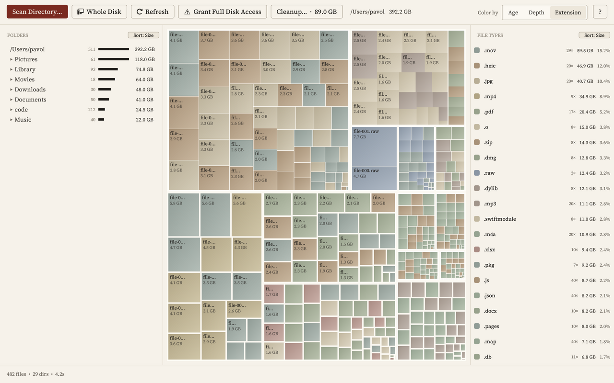

# mac-dir-stat

Treemap directory-size visualizer for macOS. Rust + [egui](https://github.com/emilk/egui).

**Website:** [mac-dir-stat.pages.dev](https://mac-dir-stat.pages.dev/) · **Changelog:** [CHANGELOG.md](CHANGELOG.md)



## Features

- **Treemap rendering** of directory contents — area = file size — with cushioned gradient colors per file type, depth, or modification age.
- **Directory tree panel** synced to the treemap; click anywhere in the treemap to reveal the location. Each folder shows its size, a percentage bar, and its **item count** (files + subdirs). Cycle the sort between **Size · Name · Items · Recent**, and navigate the whole list from the keyboard.
- **File-type breakdown** showing total bytes, percentage, and **file count** per extension; sort by **Size · Count · Name**; click a row to dim non-matching files.
- **Cleanup, as an inventory.** Two columns: what a tool can rebuild (Xcode DerivedData / Archives / Simulators / DeviceSupport, `node_modules`, `target`, Application Caches, Docker / Cargo / rustup / Gradle / Maven / Next.js / Turbo, …), each with what it takes to get it back and when it last changed; and what only you have (Photos, Documents, Movies, Music, Mail), shown with sizes and never offered for deletion. Nothing is ticked for you. Tick what you trust, confirm once, and a short account says what went to the Trash, how much of it was rebuildable, and that the Trash is not emptied yet.
- **Refresh subtree**: right-click a folder (or `⇧⌘R` on a selected one) to re-scan only that subtree without losing your current view.
- **Right-click menu** on every node — **Open**, Reveal in Finder, **Open Terminal Here**, **Get Info**, Copy Path, Refresh, Zoom Into, Move to Trash.
- **Free & unknown space** — scanning any volume root (`/` or a mounted volume under `/Volumes`) adds `<Free Space>` and `<Hidden / Skipped>` blocks so the treemap accounts for the whole disk.
- **Move to External Disk…** — right-click a file or folder to copy it to another disk, verify the copy, send the original to the Trash and optionally leave a symlink behind. See [Moving to another disk](#moving-to-another-disk).
- **Headless server with a web UI, REST API and MCP endpoint** — `mac-dir-stat serve`. See [Server, API and your own AI](#server-api-and-your-own-ai).
- **Drag-and-drop** a folder onto the window to scan it.
- **Hover tooltip** with name, full path, size, type, and relative modified time.
- **Scans on launch** — opens straight into a scan of your whole disk (or your last-scanned folder), no welcome screen to click through.
- **One-time Full Disk Access prompt** — on first run, if the app lacks Full Disk Access, it offers to open the right Settings pane once (and never nags again); protected areas otherwise show up as `<Hidden / Skipped>`.
- **Persistent state** — last scan path, color mode, and window size are restored on launch.
- **Live scan progress** — counts, bytes, current path, and skipped-error count surfaced as the walker progresses.
- **Freed-this-session counter** in the status bar — accumulates bytes trashed since the last scan started.
- **TCC-aware**: known protected paths (Photos library, Mail, Calendar, Reminders, removable volumes, …) are filtered out before traversal so you don't get a wall of macOS permission prompts on first scan.

Press `?` at any time for the keyboard shortcut list.

### Privacy

Release builds (the GitHub DMG and the Homebrew cask) send **anonymous, cookieless** usage counts: app opens, scans run and space reclaimed, never file names or paths. They are **on unless you turn them off**: press `?` and tick **Don't send anonymous usage data** under **Privacy**, or set `MACDIRSTAT_NO_TELEMETRY=1`. Builds from source send nothing, because they have no analytics endpoint.

## Compared to

| | MacDirStat | [DaisyDisk](https://daisydiskapp.com) | [GrandPerspective](https://grandperspectiv.sourceforge.net) | [WinDirStat](https://windirstat.net) |
|---|---|---|---|---|
| Platform | macOS | macOS | macOS | Windows |
| Price | **Free** | Paid | Free (donations) | Free |
| Open source | **Yes (MIT)** | No | Yes (GPL) | Yes |
| Visualization | Treemap | Sunburst | Treemap | Treemap |
| Folder list + file-type list | **Yes** | No | No | Yes |
| One-click cleanup of regenerable junk | **Yes** | No | No | No |
| Actively developed | **Yes** | Yes | Sporadic | Yes |

If you loved WinDirStat on Windows and want the same thing on a Mac — free and
open-source — that's what this is.

## Install

### Homebrew (recommended)

```sh
brew install --cask chartres/mac-dir-stat/mac-dir-stat
```

### Manual DMG

Grab the latest `MacDirStat-<version>.dmg` from [Releases](https://github.com/Chartres/mac-dir-stat/releases), open it, drag **MacDirStat** into `/Applications`.

The app is **signed with a Developer ID and notarized by Apple**, so it opens normally on first launch — no Gatekeeper workaround needed.

## Keyboard shortcuts

| Shortcut | Action |
|---|---|
| `⌘O` | Pick directory to scan |
| `⌘R` | Re-scan current root |
| `⇧⌘R` | Re-scan only the selected subtree |
| `⌘1` / `⌘2` / `⌘3` | Color treemap by extension / depth / modified age |
| `⌘F` | Search files in scanned tree |
| `↑` / `↓` | Move selection up/down the directory list |
| `→` / `←` | Expand / collapse the selected directory |
| `⌘⌫` | Move selected node to Trash |
| `↩` | Reveal selected node in Finder |
| `Esc` | Close help/cleanup/search · pop zoom · clear selection |
| `?` | Toggle help / about window |

## Moving to another disk

Moved items land at `<volume>/MacDirStat Offload/<original absolute path>`, so you can always tell
where something came from and move it back by hand. The steps are: copy with `/usr/bin/ditto`
into a temporary `<name>.mds-partial-<pid>` folder next to the destination, flush it to disk
(`F_FULLFSYNC`), check file count, total bytes and every byte against the original, rename it into
place (refusing if the destination appeared meanwhile), move the original to the Trash, then, if you
ask for it, create a symlink at the original path. A failure removes only the temporary copy.
One move or plan runs at a time.

It refuses, with the reason shown, when:

- the item is a system path (`/System`, `/usr`, `/bin`, `/sbin`, `/private` except per-user temp
  folders, `/Library` itself, `/Users/Shared`, other users' home folders, a whole volume, your home
  folder itself, `~/Library` itself). Paths are checked in their on-disk letter case, so
  `/users/me/library` is still `~/Library`;
- the destination is on the same disk, is not a mounted volume, is inside the item, or already exists;
- the destination lacks the estimated space (rounded up to its cluster size) plus 1 GiB;
- the destination is exFAT or FAT and the item is or contains an app bundle or package
  (`.app`, `.photoslibrary`, `.bundle`, `.framework`, `.pkg`), a symlink, or a file named `._*`;
- the destination is FAT32 and a file is 4 GiB or larger;
- any part of the item cannot be read.

On exFAT, Unix permissions and owners are not kept and extended attributes are stored as `._` files.

## Server, API and your own AI

```sh
/Applications/MacDirStat.app/Contents/MacOS/mac-dir-stat serve [--bind 127.0.0.1] [--port 7878] [--root /]
```

The command-line tool is the app's own binary. The Homebrew cask from 0.6.0 on also links it as
`mac-dir-stat`; with the DMG, or on an older cask, use the full path above. From a source checkout:
`cargo run --release -- serve`.

**Full Disk Access.** When `serve` runs from a shell, macOS checks Full Disk Access for the
terminal app (Terminal, iTerm, …), not for MacDirStat. Over SSH, turn on **Allow full disk access
for remote users** under System Settings → General → Sharing → Remote Login (ⓘ). Without it,
protected folders show up as skipped.

This runs without a window. It scans `--root` and prints the web UI address. In a terminal the
address includes the token (`http://127.0.0.1:7878/#token=…`); otherwise it prints where the token
file is, so the token stays out of log files. The page works on a phone in light and dark mode. It shows
disks and free space, the largest folders and files, cleanup groups, and a find box (`node_modules`,
`.venv`, `*.dmg`, …). Tick items, choose **Move to Trash** or **Move to <disk>**, and create a
**plan**. The plan lists every item with its size, destination, errors and warnings. Nothing runs
until you press **Approve**.

It listens on `127.0.0.1` only, so a phone cannot reach it until you pass `--bind`. Over
Tailscale, bind to the Mac's Tailscale IP (`--bind 100.x.y.z`; `tailscale ip -4` shows it) and
open the printed `http://100.x.y.z:7878/#token=…` link on the phone. `--bind 0.0.0.0` exposes it
to every network the Mac is on.

**Auth.** Every `/api` and `/mcp` request needs `Authorization: Bearer <token>`. There are two
tokens, generated on first run in `~/Library/Application Support/MacDirStat/` (mode 0600):

- `server-token` (admin) can do everything, including approve and reject. It is for you and the web page.
- `mcp-token` (AI) can read everything, propose plans, and start a rescan through the MCP `scan`
  tool. It cannot approve, reject or run a plan: those requests, and the REST rescan
  (`POST /api/v1/scan`), return 403. Give this one to AI clients.

Delete a file to rotate its token.

**REST API**, versioned under `/api/v1`, JSON in and out, described by an OpenAPI 3.1 document at
`/api/v1/openapi.json`:

| Method | Path | |
|---|---|---|
| GET | `/volumes` | startup disk and `/Volumes/*`, with fs type, free and total bytes |
| GET / POST | `/scan` | scan status / start a new scan (`{"root": …}`) |
| GET | `/tree?path=&limit=` | a folder and its children, largest first |
| GET | `/top?n=&kind=file\|dir` | largest files or content folders |
| GET | `/find?pattern=&limit=` | glob on names, with sizes, modified times and a total |
| GET | `/cleanup` | regenerable data grouped by category |
| GET | `/summary` | plain-text digest for pasting into any chat |
| GET / POST | `/plans` | list / propose (`{"ops":[{"action":"trash"\|"move","path":…,"volume":…,"link":true}]}`) |
| GET | `/plans/{id}` | one plan with per-op results |
| POST | `/plans/{id}/approve` · `/reject` | run it (pending → approved → done/failed) or reject it |

**Bring your own AI.** MacDirStat never calls an AI. You can connect one in two ways:

- **MCP** at `/mcp` (Streamable HTTP, JSON responses). The tools are `list_volumes`, `scan`, `get_tree`,
  `top_items`, `find`, `cleanup_suggestions`, `propose_plan`, `list_plans` and `get_plan`. No tool
  approves or runs a plan: the AI proposes and you approve in the web UI.
  ```sh
  claude mcp add --transport http macdirstat http://127.0.0.1:7878/mcp \
    --header "Authorization: Bearer $(cat ~/Library/Application\ Support/MacDirStat/mcp-token)"
  ```
- **Any chat.** **Copy summary for any chat** in the web UI copies the largest items, the cleanup
  groups and your disks, with instructions to answer in plan JSON. Paste the answer into
  **Create plan from JSON** and review it like any other plan.

## Build from source

```sh
cargo run --release
```

Build a universal `.app` + DMG:

```sh
./scripts/bundle.sh   # produces dist/MacDirStat.app
./scripts/dmg.sh      # produces dist/MacDirStat-<version>.dmg
```

Tag-driven release: pushing `vX.Y.Z` (it must match the version in `Cargo.toml`) triggers `.github/workflows/release.yml`, which builds a signed, notarized universal DMG, publishes it to GitHub Releases and bumps the Homebrew cask.

## Architecture

- `src/scanner/` — parallel filesystem walk via [jwalk](https://github.com/byron/jwalk), TCC-protected paths filtered up front.
- `src/treemap/` — squarified treemap layout, color gradients, palette.
- `src/ui/` — egui chrome: toolbar, side panels, treemap viewport, search, cleanup window, context menu.
- `src/cleanup.rs` — heuristic detection of regenerable directories.
- `src/relocate.rs` — move-to-another-disk rules (pure) and copy / verify / trash / link (IO).
- `src/plan.rs` — plans of trash/move ops and their approval state machine.
- `src/server/` — `serve`: HTTP routing and auth (`mod.rs`), REST handlers (`api.rs`), MCP (`mcp.rs`), the embedded web page and OpenAPI document.
- `src/state.rs` — persisted UI state (scan root, color mode).
- `src/flywheel.rs` — anonymous usage counts, on in release builds unless turned off (see [Privacy](#privacy)).
