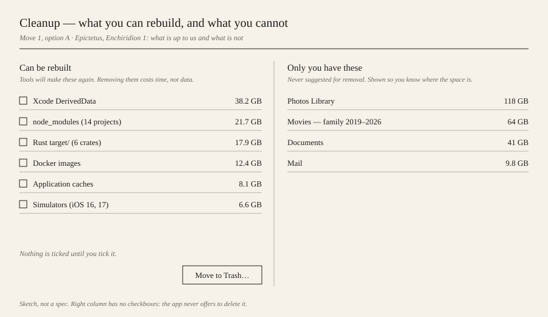
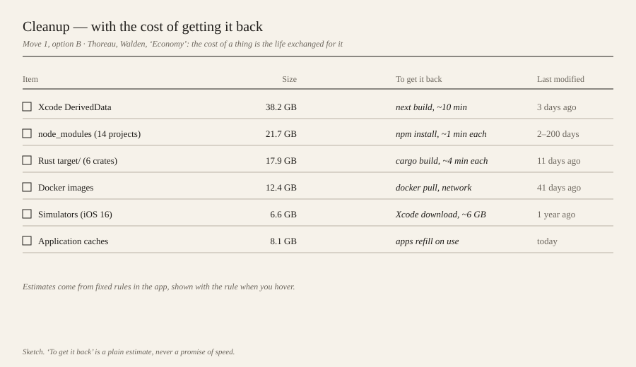
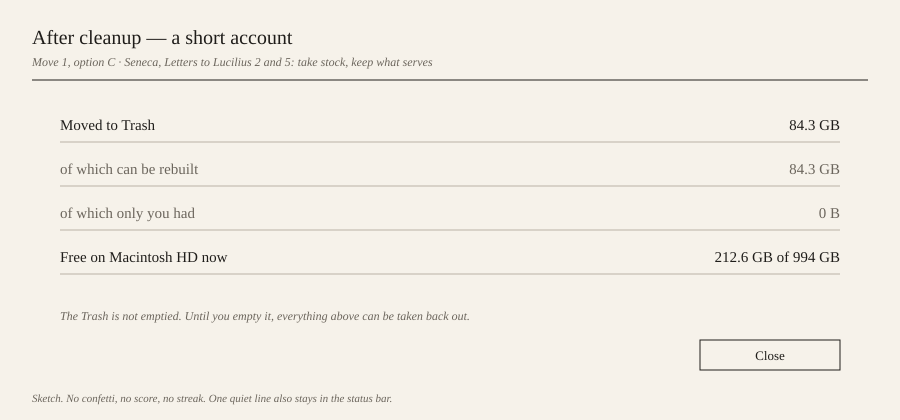
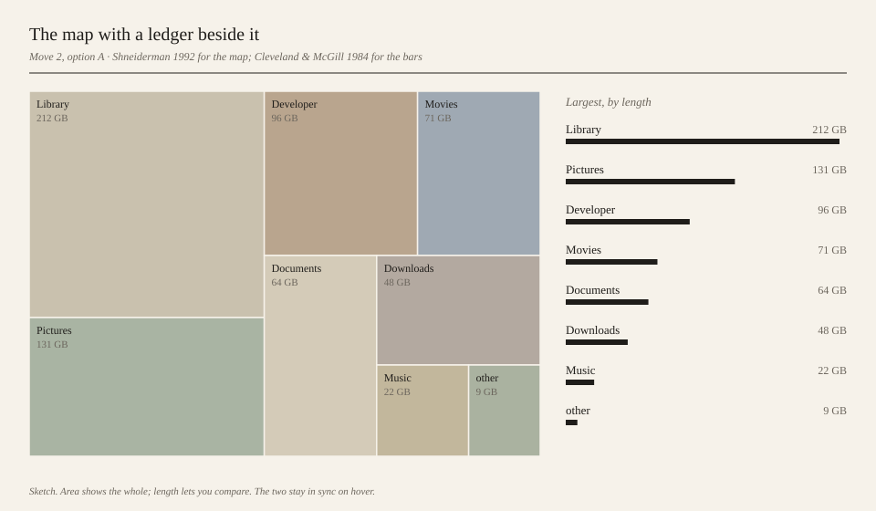
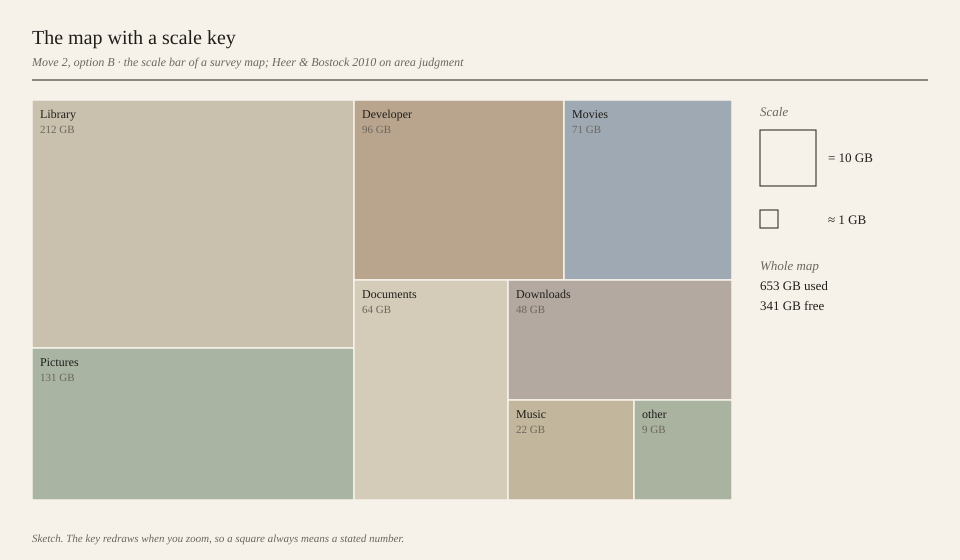
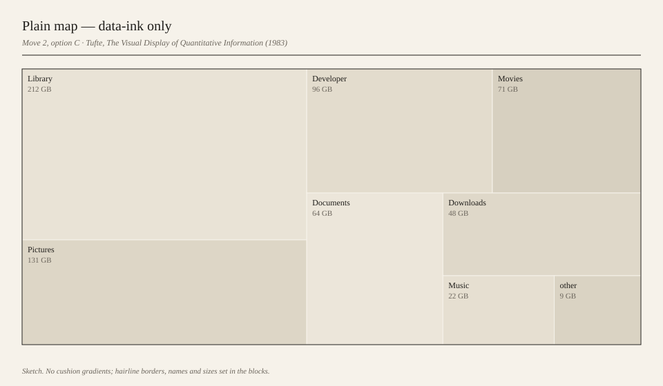
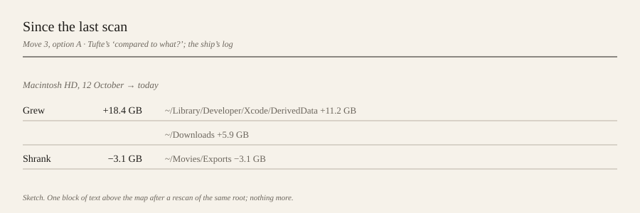
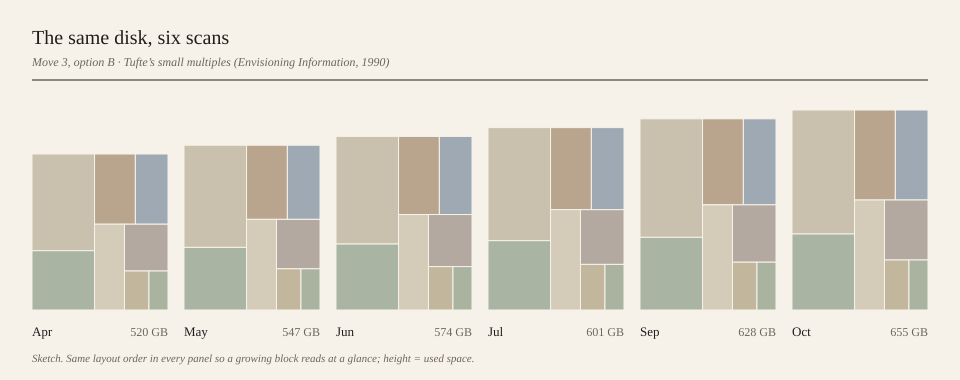
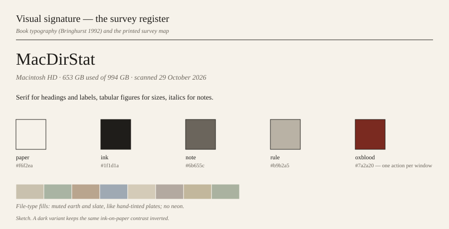

# Signature — mac-dir-stat

Status: **picked** 2026-10-30 (see the decision log in §6) · drafted 2026-10-29.

A disk-space tool sits next to a lot of fear-selling software. The signature this proposal argues
for is the opposite of that: a calm inventory of what you keep, which separates what can be
rebuilt from what only you have, and states sizes in a way a person can actually compare. It
borrows from the people who first drew treemaps and measured how we read charts, and from older
writers who took stock of their possessions without panic.

Mock-ups are in [`docs/signature/`](signature/). They are sketches, not specs.

---

## 1. Lineage

| # | Source | Year | Why it fits a disk tool | changes: |
|---|---|---|---|---|
| L1 | Ben Shneiderman, *Tree visualization with tree-maps: a 2-d space-filling approach* (ACM Transactions on Graphics); with van Wijk & van de Wetering's cushion treemaps (1999) and Bruls, Huizing & van Wijk's squarified layout (2000) | 1992 | Shneiderman drew the first treemap to find out what was filling a shared hard disk. This app is a direct descendant, and its layout (`src/treemap/squarify.rs`) and cushions (`color.rs`) already come from this line. | Keep the squarified layout; add a **scale key** so a block's area always maps to a stated number of bytes (Move 2B), and offer a **plain map** without cushions (Move 2C). |
| L2 | William S. Cleveland & Robert McGill, *Graphical Perception* (JASA); replicated with crowdsourced subjects by Heer & Bostock (CHI 2010) | 1984 | Both studies rank how accurately people read encodings: position and length beat area by a wide margin. A treemap is good for seeing the whole and poor for comparing two blocks. | Put a **ranked length ledger** beside the treemap, synced on hover, so comparisons use length, not area (Move 2A). |
| L3 | Edward Tufte, *The Visual Display of Quantitative Information* (data-ink, "compared to what?") and *Envisioning Information* (small multiples) | 1983 / 1990 | A disk changes slowly, and a single scan says nothing about direction. Tufte's answer is the same picture repeated over time, and ink spent only on data. | **Since the last scan** summary and **small multiples** of past scans of the same root (Move 3); remove decorative gradients in plain mode (Move 2C). |
| L4 | Epictetus, *Enchiridion*, ch. 1 (the things up to us and the things not) | c. 125 | The useful split on a disk is not big/small but **rebuildable/irreplaceable**. A tool can rebuild `node_modules`; nothing rebuilds a family video. Epictetus' first chapter is exactly that kind of sorting. | The Cleanup window becomes a two-column **inventory**: what can be rebuilt (selectable) and what only you have (shown, never offered for deletion) (Move 1A). |
| L5 | Henry David Thoreau, *Walden*, ch. 1 "Economy" | 1854 | Thoreau prices things in the life spent to get them. For regenerable data the honest price of deleting it is the time to get it back. | Each cleanup row shows **"to get it back"**: the command and a plain time estimate (Move 1B). |
| L6 | Seneca, *Letters to Lucilius*, 2 and 5 (on keeping what serves and not owning for show) | c. 65 | Seneca's habit is a short, sober account at the end of the day. After cleanup, an account says what left and what is still recoverable, and nothing else. | A **closing account** after a trash action, replacing nothing louder (Move 1C). |

Weighed and left out:
- **Ars memoriae / memory palaces.** About recall, not about measuring or letting go; it would push
  toward a spatial metaphor the treemap already provides.
- **Cabinet of curiosities.** It is a way of displaying a collection for wonder; this app's job is
  the opposite, to make the large and dull visible. It may suit a photo or note product better.

---

## 2. Refused

What this app will not do, whatever it would do for a metric:

| Refused | Why |
|---|---|
| Scare-ware: "Your Mac is full!", red badges, alarming gauges, fake "junk found" totals | Article VIII. The disk is what it is; the app reports it. Warnings appear only when an action is risky (credentials in Gradle/Maven, Docker volumes), which the app already does. |
| Claims that cleaning makes a Mac faster | We can't back it. Freeing space rarely changes speed unless the disk is nearly full. |
| Pre-ticked checkboxes, deletion as the default, countdowns, nagging re-prompts | Dark patterns that push deletion. Today nothing in Cleanup is pre-ticked (`cleanup_selected` starts empty) and every trash asks once; keep it that way. The existing "Select all" button stays, but is never pressed for you. |
| Offering irreplaceable data (Photos, Documents, Mail, iCloud Drive) for deletion | The app can't know it is safe. Shown for awareness only. iCloud Drive is already excluded (founder case 5). |
| Subscription, trial-to-paid, "Pro unlock" bait | The product is free and MIT. Support goes through `FUNDING.yml`, stated plainly. |
| Streaks, scores, confetti, "you saved X this week!" pushes | Article II: the tool is episodic. It should be opened when needed and then closed, not compete for attention. |
| Background agents or menu-bar monitors that wake the user | Same reason, and they need more permission than a scan tool should ask for. |
| An AI that deletes on its own | Already refused in code: the MCP token can propose plans, never approve them (founder case 8). |
| Telemetry beyond counts | Never file names or paths; opt-out stays one tick in the `?` window. |

---

## 3. Signature moves

Each move has options. **Status for all: `proposed`.**

### Move 1 — The inventory (Cleanup window)

From L4, L5, L6. Today's Cleanup window lists regenerable candidates by category. These options
change what the person is asked to decide.

| Option | What the user sees | Sketch | Source | Metric that shows it works |
|---|---|---|---|---|
| **1A. Two columns** | Left: "Can be rebuilt", with checkboxes. Right: "Only you have these" (Photos, Movies, Documents, Mail), sizes only, no checkboxes. |  | Epictetus, *Enchiridion* 1 | Conversion rate (scan-completers who free any bytes) rises; median bytes freed per conversion holds or rises. Guard: no data-loss reports in issues. |
| **1B. Cost to get it back** | One list, with a column "To get it back" (`npm install, ~1 min each`) and "Last modified". |  | Thoreau, *Walden*, "Economy" | Share of selected bytes from items last modified > 30 days ago rises (people trash the right things); conversion rate holds. |
| **1C. Closing account** | After a trash, a short panel: moved to Trash, how much was rebuildable vs only yours, free space now, and that the Trash is not emptied. |  | Seneca, *Letters* 2 and 5 | Return scans within 90 days (episodic reuse) rise; no rise in "I deleted the wrong thing" issues. |

**Recommendation: 1A, with 1B's "to get it back" as one line under each left-column row.** 1A
carries the whole idea in one look and is the move no competitor makes. 1C is cheap and can
follow later.

### Move 2 — Honest scale (the treemap)

From L1, L2, L3. The treemap stays; these options make its sizes readable.

| Option | What the user sees | Sketch | Source | Metric that shows it works |
|---|---|---|---|---|
| **2A. Ledger beside the map** | A ranked list of the current level's largest children, each with a length bar and exact size, synced with the map on hover and click. |  | Shneiderman 1992; Cleveland & McGill 1984 | Time from scan done to first trash (`conversion` event) falls. Zoom-ins per session would also fall, but zooms are not counted today and would need a new `key_action`. |
| **2B. Scale key** | A small key: "this square = 10 GB", redrawn on zoom, plus used/free totals. |  | Survey-map scale bar; Heer & Bostock 2010 | Same as 2A; cheaper to build, likely smaller effect. |
| **2C. Plain map** | A colour mode with no cushion gradients: flat muted fills, hairline borders, names and sizes set inside the blocks. |  | Tufte 1983, data-ink | Share of sessions that choose plain mode once offered; screenshots shared (stars and site referrals after posts). |

**Recommendation: 2A.** It is the direct fix for the known weakness of treemaps and the right
panel already exists (the directory tree); the ledger can live there. 2B is a cheap add-on. 2C
belongs to the visual signature below rather than a move of its own.

### Move 3 — The disk over time

From L3. Today each scan stands alone.

| Option | What the user sees | Sketch | Source | Metric that shows it works |
|---|---|---|---|---|
| **3A. Since the last scan** | After a rescan of the same root, one block: grew by X, the two or three folders that grew most, what shrank. |  | Tufte, "compared to what?"; the ship's log | 90-day return scans per install rise (the guard metric in `flywheel.json`: weekly scan-completers). |
| **3B. Small multiples** | Six small treemaps of past scans of the same root, same layout order, height proportional to used space. |  | Tufte, *Envisioning Information* | Same as 3A, plus opens of the history view. Needs scan summaries stored locally. |
| **3C. Nothing** | No history. Each scan stands alone, as today. | — | — | Baseline. Choose this if storing scan summaries on disk feels like more than the app should keep. |

**Recommendation: 3A.** It needs only the top-level sizes of the previous scan saved next to
`state.rs`'s data, it answers the question people actually return with ("what grew?"), and it adds
no new window. 3B can come once 3A shows that people rescan.

---

## 4. Visual signature

**Tradition: book typography and the printed survey register.** Robert Bringhurst's *The Elements
of Typographic Style* (1992) for type, Tufte's own books for the plain chart page, and
19th-century cadastral survey maps for the treemap: hand-tinted parcels, hairline boundaries, a
scale bar, names set in the parcel.

- **Type:** a serif with tabular figures for headings, labels and sizes (an OFL face bundled with
  the app, e.g. Source Serif 4); italics for notes and explanations, not bold.
- **Colour:** paper `#f6f2ea`, ink `#1f1d1a`, notes `#6b655c`, rules `#b9b2a5`. One accent,
  oxblood `#7a2a20`, used for at most one action per window. This replaces the violet accent in
  `src/ui/theme.rs`, which reads as the generic AI-app look the signature brief asks to move away from.
- **File-type fills:** muted earth and slate, like tinted plates; no neon, no rainbow.
- **Dark mode:** kept, as the same ink-on-paper contrast inverted, not a separate neon scheme.
- **Words:** sizes and facts, plain verbs ("Move to Trash", "Reveal"), no exclamation marks.

---

## 5. Founder lens

- **Article II.** The app is episodic: open, find, clear, close. No streaks, notifications or
  background monitors (see Refused). For Pavol it is low upkeep: all moves are local UI, no
  servers, no accounts.
- **Article VI.** What others can't copy here is the set of rules for what is safe to rebuild,
  written down once and tested as founder cases; the trust an honest tool earns in a category
  full of scare-ware; and the Homebrew cask and GitHub as the way people find it. The inventory
  in Move 1 puts those rules on screen.
- **Article VIII.** Every claim on screen must be backed: no "faster Mac", no fake junk totals, no
  pre-ticks. Time estimates in 1B are labelled as estimates and show their rule. The README's
  comparison table should be rechecked against the note below before the next release.

---

## 6. Decision log

| Date | Move | Option chosen | By | Why |
|---|---|---|---|---|
| 2026-10-30 | 1. Inventory | 1A two columns, 1B cost to get it back, 1C closing account | Pavol | "All three". |
| 2026-10-30 | 2. Honest scale | 2A ledger beside the map | Pavol | "Merge the ledger with the file/folder list". The ledger lives in the existing directory list beside the treemap, not in a new panel. |
| 2026-10-30 | 3. The disk over time | 3B small multiples of past scans | Pavol | Store a small summary per scan (totals and top folders, no file lists), show at most 6, and keep scans on the Mac: nothing leaves the machine. |
| 2026-10-30 | Visual signature | Survey register (serif, paper, oxblood accent) | Pavol | Replaces the violet, dark-first theme. Keep a dark variant that follows the system setting. |
| 2026-10-30 | All products | A move approved for one product may be reused by another | Pavol | "Dont just blindly copy the pattern though." |

---

## Appendix — competitive note

Prices checked 2026-10-29.

| App | Price | What it does |
|---|---|---|
| [DaisyDisk](https://daisydiskapp.com) | $9.99 one-time (up to 5 Macs); Mac App Store and direct | Interactive sunburst of a disk; drag items to a "collector" and delete in one go; shows purgeable and hidden space. Polished, closed source. |
| [GrandPerspective](https://grandperspectiv.sourceforge.net) | Free (GPL) from SourceForge; about $2.99 / €3 "supporter" price on the Mac App Store | Treemap of a folder or disk with colour by folder, type or age; filters; still updated (2026 release). No cleanup guidance. |
| [OmniDiskSweeper](https://www.omnigroup.com/more) | Free | Column browser sorted by size, with delete. No visualisation. Updates are rare. |
| [Disk Inventory X](https://www.derlien.com) | Free (GPL) | Treemap plus file-type list, the closest Mac port of WinDirStat's idea. Development is largely dormant. |
| macOS Storage settings | Built in | Category bar (Apps, Documents, Photos, "System Data") and recommendations (Store in iCloud, Optimise Storage, empty Trash automatically). Opaque about what "System Data" is. |

**The gap this app can own:** none of these separates what a tool can rebuild from what only you
have, or tells you what deleting something will cost you to get back. DaisyDisk is the polished
choice but closed and paid; the free ones show sizes and leave the judgment to you; Apple's panel
hides the biggest category. A free, open-source treemap that hands you an honest inventory, says
plainly what is safe, and lets your own AI propose but never approve, is a position no one holds.

Note for the README: its comparison table marks DaisyDisk "No" for one-click cleanup and
GrandPerspective "Sporadic" for development. DaisyDisk's collector deletes in one action, and
GrandPerspective shipped a release in 2026. Both cells should be rechecked (Article VIII).
