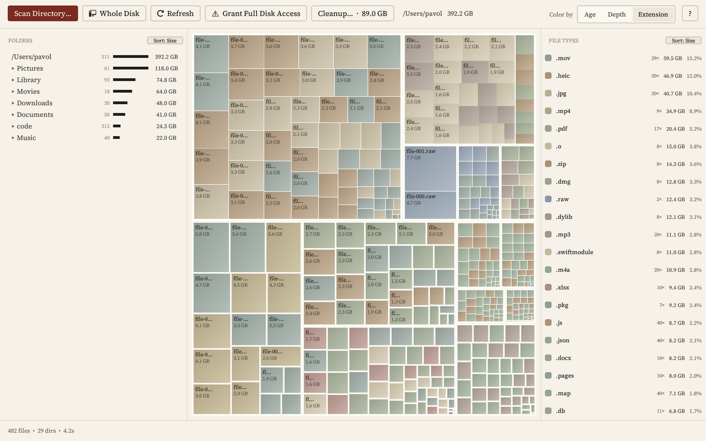

# MacDirStat 0.7.0

Draft for Pavol. Not published. To release: check the app on a Mac, then
`git tag v0.7.0 && git push origin v0.7.0` (the version in `Cargo.toml` is already 0.7.0).
The release workflow writes GitHub's generated notes, not this file; once it has run, replace
them with everything below the line: `gh release edit v0.7.0 --notes-file <this file minus
this preamble>`. Put the date in CHANGELOG.md's 0.7.0 heading at the same time.

---

This release changes how MacDirStat looks and what it asks you to decide. It is still free, still
reads your disk only on your Mac, and still deletes nothing until you confirm.

## Cleanup is now an inventory

The Cleanup window has two columns.

- **Can be rebuilt.** Caches, build output, `node_modules`, simulators (their apps and data are not rebuilt) and the like, grouped by
  rule. Each rule says what it takes to get it back (`npm install`, the next Xcode build, the next
  `cargo build`) and when anything inside last changed.
- **Only you have these.** Your Photos library, Documents, Desktop, Pictures, Movies, Music, Mail
  and Messages, with their sizes. They have no tick boxes. MacDirStat never offers them for
  deletion; they are there so you know where the space is.

After you move things to the Trash, a short account says how much went, how much of it a tool can
rebuild, how much free space the disk has, and that the Trash is not emptied yet, so you can still
take anything back out.

## A ledger beside the map

The folder list now works as a ledger of the folder the map shows. Each row has its exact size and
a bar whose length you can compare with its neighbours: people judge length much better than area.
A folder's own files get one row, so the bars at each level add up. Hover a row and the map
outlines that folder; hover the map and the row lights up.

## History

**History…** shows the folder you scanned over its last six scans, side by side, as small treemaps
in the same order, each as tall as the space used. You can see what grew without comparing numbers.

Each finished scan keeps a short summary on your Mac: the folder you scanned, the date, the total,
the names and sizes of its eight largest top-level folders, and the rest as unnamed sums. It keeps
no file names or lists, and it never sends anything anywhere. The
summaries live in `~/Library/Application Support/mac-dir-stat/history.json`; delete that file to
forget them.

## Getting around

- **Path bar.** Under the toolbar: the folder the map shows, as clickable segments (the current one
  in bold), with Back and Up buttons. Backspace or ⌘↑ goes up a folder; ⌘[ goes back to where you were.
- **Pinned parents.** Scroll deep into the folder list and the folders above stay pinned at the top
  (up to four). Click one to jump to it; its triangle closes it.
- **The triangle works.** Clicking ▶ in the folder list opens a folder and ▼ closes it. Before, the
  click selected the row instead.
- **The pointer changes** to a hand over anything you can click, and to a resize arrow on the
  dividers between the three panels.
- **Colour legends.** With Age or Depth selected, a bar at the right of the path bar shows what the
  colours mean: new to old (today, 1 mo, 1 y, 3 y or older) or shallow to deep (levels 1 to 5+,
  counted from the folder shown). Age now runs on a three-year log scale instead of saturating at one
  year.
- **Faster.** The folder list draws only the rows in view, and the map merges blocks smaller than a
  pixel. On `~/Library` (275,000 files, 5,200 folders open) a frame went from 46 ms to 0.8 ms.
- **Fewer words.** Explanatory sentences are gone from the Cleanup, History and Full Disk Access
  windows and the tooltips.
- **A new icon.** A treemap of nested blocks on paper, as a macOS icon.

## A new look

Serif type (Source Serif 4, bundled), ink on paper, thin rules, and one dark-red accent for the
main action in each window. Treemap colours are muted earth and slate. There is a dark version
too, and it follows your macOS appearance setting.

## Install or update

- Download the DMG below, or
- `brew upgrade --cask mac-dir-stat` (new installs: `brew install --cask chartres/mac-dir-stat/mac-dir-stat`).

Usage counts (app opens, scans, space freed; never file names or paths) work as in 0.6: on in
release builds, off with one tick under Privacy in the `?` window. This release adds no new
telemetry and no network calls.
